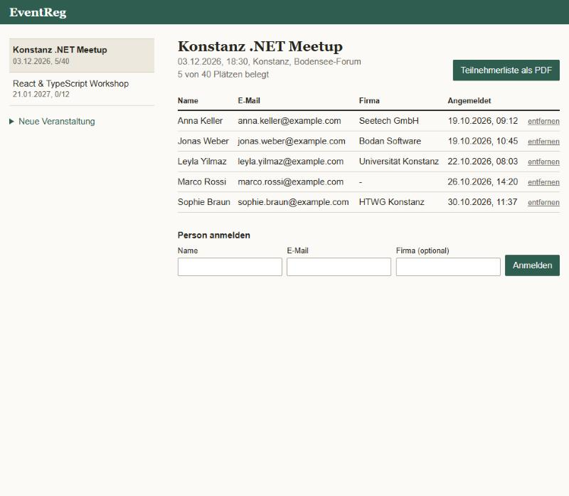
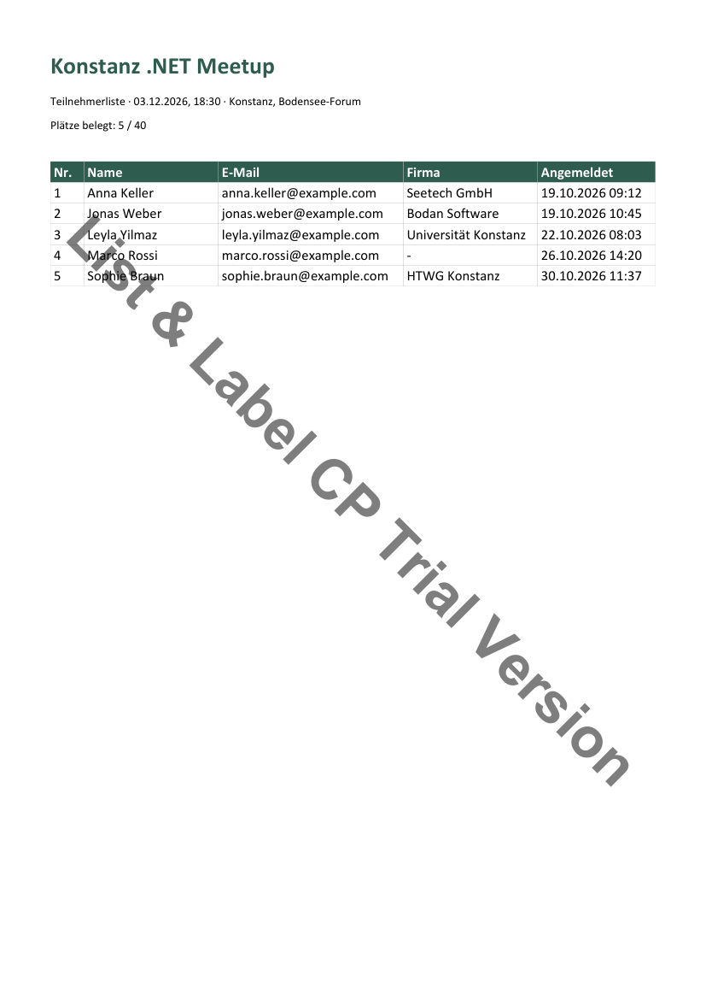

# EventReg

Kleine Webanwendung zur Verwaltung von Veranstaltungen und Anmeldungen. Teilnehmerlisten werden mit **List & Label** serverseitig als PDF erzeugt.



## PDF-Bericht

Der Button „Teilnehmerliste als PDF“ erzeugt pro Veranstaltung einen Bericht mit Kopfdaten, Belegung und Teilnehmertabelle. Bei längeren Listen läuft die Tabelle automatisch auf die nächste Seite, und der Tabellenkopf wird wiederholt.

[Beispiel-PDF ansehen](docs/teilnehmerliste-beispiel.pdf)



Das Wasserzeichen „List & Label CP Trial Version“ stammt von der Evaluierungsversion. Mit einem Lizenzschlüssel (`ListLabel:LicenseKey`) entfällt es.

## Warum List & Label?

Ein PDF ließe sich auch mit HTML-zu-PDF oder einer einfachen PDF-Bibliothek erzeugen. Ich wollte aber ausprobieren, wie eine Reporting-Komponente den Bericht von der Anwendung trennt:

- **Daten und Layout sind getrennt:** Die Anwendung übergibt nur eine Liste von Objekten über den `ObjectDataProvider`. Das Layout liegt in einer eigenen Projektdatei.
- **Seitenumbrüche übernimmt die Engine:** Tabellenköpfe, Spaltenbreiten und Folgeseiten muss ich nicht selbst berechnen.
- **Es läuft im Backend ohne native Abhängigkeiten:** Die Cross-Platform-Edition ist rein verwaltetes .NET und passt daher gut zu ASP.NET Core.
- **Berichte sind versionierbar:** Das Projekt ist eine JSON-Datei und kann wie Code in Git verwaltet werden.

Die Cross-Platform-Edition enthält keinen Designer. Deshalb baut `ParticipantReport.cs` das Layout einmalig über die DOM-API auf und speichert es als `server/Reports/participants.json`. Wird die Datei gelöscht, entsteht sie beim nächsten Bericht neu.

## Technik

| Bereich | Technologie |
| --- | --- |
| Backend | ASP.NET Core 8 (Minimal API), C# |
| Datenbank | SQLite mit Entity Framework Core |
| Frontend | React, TypeScript, Vite |
| Reporting | List & Label Cross Platform 31 |

## API

| Methode | Pfad | Zweck |
| --- | --- | --- |
| GET | `/api/events` | Veranstaltungen mit Belegung |
| POST | `/api/events` | Veranstaltung anlegen |
| GET | `/api/events/{id}/registrations` | Anmeldungen lesen |
| POST | `/api/events/{id}/registrations` | Anmelden (prüft Kapazität und doppelte E-Mail) |
| DELETE | `/api/events/{id}/registrations/{registrationId}` | Anmeldung entfernen |
| GET | `/api/events/{id}/participants.pdf` | Teilnehmerliste als PDF |

## Starten

Voraussetzungen: .NET 8 und Node.js. Beim ersten Start wird die SQLite-Datenbank mit Beispieldaten angelegt.

```bash
dotnet run --project server --launch-profile http
```

```bash
npm --prefix client install
```

```bash
npm --prefix client run dev
```

Die Anwendung läuft danach unter http://localhost:5173, die API unter http://localhost:5080.
